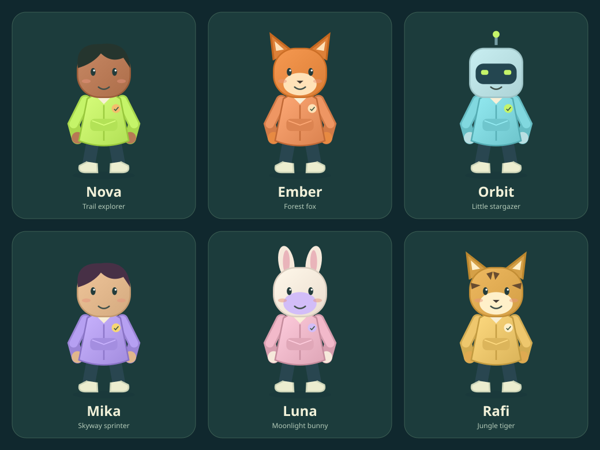

# MoveRush

Move your body. Race your friends. Escape the wild.

MoveRush is a browser-based runner prototype with webcam gestures, an endless solo chase, and competitive split-screen races. It runs locally with Node.js and requires no package installation.



## Run locally

Requires **Node.js 20 or later**.

```sh
npm start
```

Open **http://localhost:3000** on the computer running the server. Choose a mode, difficulty and character, then press **Let's run** to open the movement check.

## Game modes

- **Solo escape:** run endlessly, collect coins and avoid obstacles while a beast follows. Normal and Hard end after too many mistakes. Easy / Kid mode lets children continue after bumps.
- **Multiplayer race:** Player 1 runs on the left and Player 2 on the right. Each has independent coins, obstacles and progress. A clean run takes approximately five minutes; each hit slows that player to 38% speed for three seconds. First across the finish line wins; gold is scored separately.
- **Easy, Normal and Hard:** change pace, obstacle spacing and action timing. Race distance scales with difficulty to preserve the approximately five-minute clean run.

Both racers receive the same obstacle sequence at the same course distances. The first finisher waits while the other runner finishes. Finish times decide the winner, including photo finishes.

## Controls

| Action | Player 1 | Player 2 |
| --- | --- | --- |
| Move left / right | Left / Right arrows | A / D |
| Jump | Up arrow or Space | W |
| Slide | Down arrow | S |
| Pause / resume | P | Main screen only in room play |

Touch buttons and swipes are also supported. Sound can be muted in the header.

### Camera controls

1. Open **Let's run → Enable camera test** and allow camera access.
2. Stay upright and still for the three-second calibration.
3. Wave or lean to verify that your preview character moves.
4. Open your hands, then clap at chest height to mark yourself ready. Both multiplayer participants must be ready before a shared three-second countdown starts the race. The Ready button is an alternative.

**Near camera** is the default: only your face and shoulders need to be visible. Lean to steer, raise both hands to jump, and lower your head to slide. **Full body** mode supports physical jumping, crouching and stepping/hopping. Automatic running is enabled for initial testing and can be disabled. Sensitivity and recalibration controls are available.

A shared webcam can track two people standing side by side; keep your position on your own side of the mirrored preview. Each player has a separate calibration and readiness state. A camera zoom slider appears only if the device/browser exposes a supported zoom range. Software cannot create a wider field of view for a fixed lens.

Pose processing happens on the camera device. No camera frames are uploaded or recorded. MediaPipe library and model downloads require internet access. Clap detection uses wrist movement, not a microphone.

## Pair screens and phones

1. On the main screen, select the game mode and difficulty.
2. Open **Devices & rooms → Create room**.
3. On another device, open the address shown, enter the six-character code, and select **Phone controller / camera** or **Game screen + controls** and a player slot.
4. The main screen opens the movement check. Each player tests movements and claps when ready.

Supported layouts include:

- Solo: one display + one phone controller.
- Shared TV: one split-screen display + two phone controllers.
- Separate locations: two displays and optionally a phone controller for each player, all connected to the same hosted server.

Room games run on the server. Each remote device can control only its assigned player. A device disconnect pauses the room; reconnect and resume from the main screen. Rooms are temporary and are removed when the main screen leaves or the server restarts. Anyone with a room code can join an available device/player slot. There are no accounts or public room listings.

## HTTPS and deployment

**The Vercel deployment serves the playable frontend. Online rooms and phone pairing are not deployed there yet.** Physical phone cameras require a trusted HTTPS game address. Local HTTP supports displays and touch controls; `localhost` permits camera access only on the computer running the server.

For same-Wi-Fi devices, use the LAN address shown in the room panel instead of `localhost` on the phone. Reachability depends on existing firewall/router settings; this project does not change them.

For worldwide play, deploy the included Node server on a host with HTTPS and streaming HTTP support. Static-only hosting, including GitHub Pages by itself, cannot run the room server. A Dockerfile is included. Configure `PORT` and optionally `HOST`. A reverse proxy can terminate HTTPS; disable buffering for `/api/rooms/*/events`. Alternatively, set `TLS_CERT` and `TLS_KEY` to existing trusted certificate/key paths. Do not commit certificates, private keys or environment secrets.

## Characters

Choose from six original SVG characters: **Nova, Ember, Orbit, Mika, Luna and Rafi**. Each player can choose a character, outfit color, human skin tone and a cap or headphones. The same editable artwork appears in the menu, movement check and animated canvas runner. No licensed cartoon characters or external avatar image downloads are included.

## Checks

```sh
npm test
npm run check
```

Tests cover artwork/customization, gameplay rules, independent race progress, slowdown penalties, finish timing, camera gesture interpretation, calibration, wave/clap readiness, shared countdowns, near-camera controls, four-device room synchronization, assigned inputs, reconnects and client scripts with a simulated DOM/canvas.

Physical gesture comfort, varied lighting, real phone/TV browser compatibility, real speaker output and cross-country latency still need device testing. The graphics use stylized perspective Canvas rendering rather than a full 3D engine.

## Project files

- `core.js`: shared gameplay simulation.
- `game.js`: rendering, menus, camera integration and input.
- `motion.js`: calibration and gesture interpretation.
- `avatars.js`: original character artwork and customization.
- `rooms.js`: browser room client and controller pairing.
- `server.cjs`: static serving, room lifecycle and server-side race simulation.

MediaPipe reference: [Pose Landmarker for Web](https://developers.google.com/edge/mediapipe/solutions/vision/pose_landmarker/web_js).

### Vercel configuration

Import this repository with Root Directory set to the repository root. The committed vercel.json explicitly selects Other (framework null), runs npm run build, and serves dist. The build also writes a static Build Output API manifest; server.cjs is not deployed as a Vercel Function. This fixes the FUNCTION_INVOCATION_FAILED error caused by invoking the persistent room server as a function. Solo, local split-screen races, camera tracking, avatar selection and clap readiness run in the browser. The Devices & rooms panel explicitly reports that network pairing needs a connected room server.

For local development and full room-server tests, npm start continues to run the existing persistent Node server. Changing the Vercel root directory to a different subfolder overrides which project is imported; keep it at the repository root.
